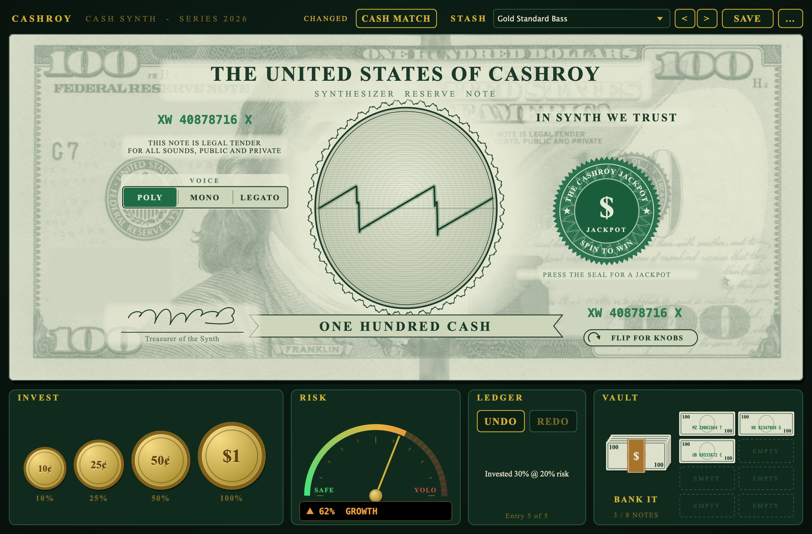
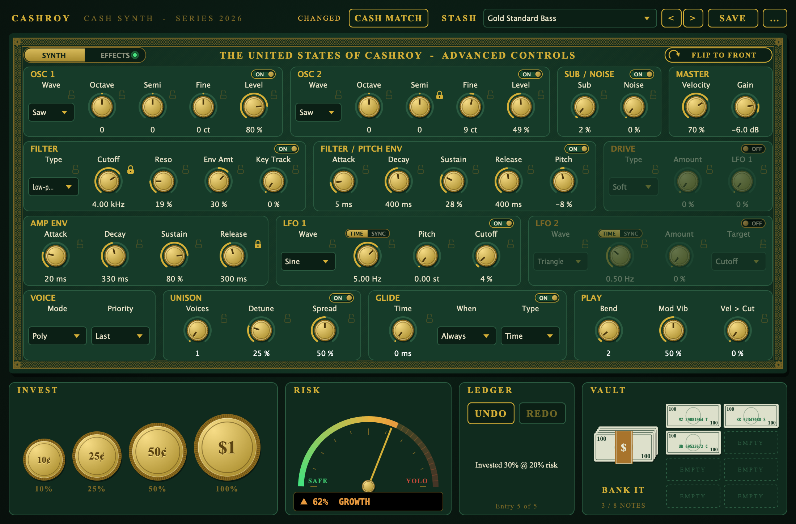
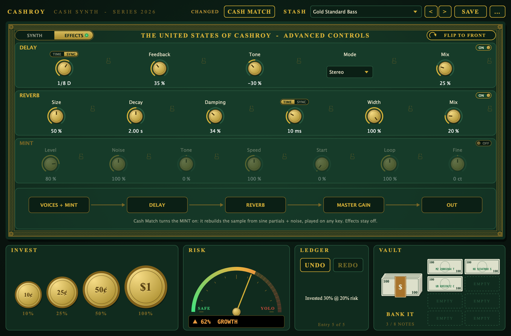
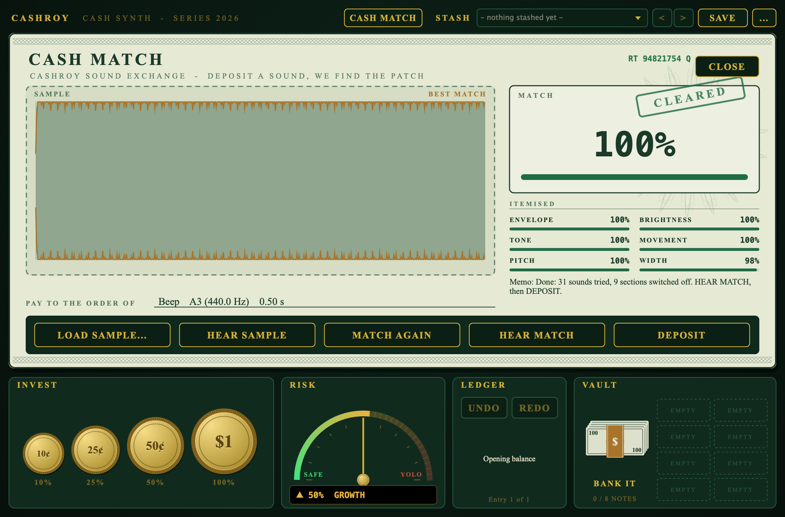

# Cash Synth

A money-themed synthesizer plugin by **Cashroy**, built with JUCE 8. The front panel is a
$100 bill: the portrait oval is a live scope, the Treasury seal is a Jackpot button and the
serial numbers are the sound's own fingerprint. Flip the bill over for every knob.

Under the jokes it's a real synth: two oscillators + sub + noise, a state-variable filter,
drive, two LFOs with tempo sync, poly/mono/legato with glide and unison, a stereo delay and
reverb. On top of that sits **Cash Match**: drop in a sample and the synth rebuilds it
(the MINT), then lets you play it on any key.



| Back: synth controls | Back: effects + the MINT |
| --- | --- |
|  |  |



## Formats

- **VST3** (macOS, Windows)
- **AU** (macOS)
- **Standalone** app

Built plugins are copied to the user plug-in folders after each build
(`~/Library/Audio/Plug-Ins/VST3` and `~/Library/Audio/Plug-Ins/Components` on macOS).

## Building

Needs CMake 3.22+ and a C++20 compiler (Xcode or the Command Line Tools on macOS,
Visual Studio 2022 on Windows). JUCE 8 and Catch2 are fetched automatically the first
time you configure.

macOS / Linux-style (Unix Makefiles):

```bash
cmake -B build -G "Unix Makefiles" -DCMAKE_BUILD_TYPE=Debug
cmake --build build -j8
ctest --test-dir build --output-on-failure
```

For a Release build use its own folder:

```bash
cmake -B build-release -G "Unix Makefiles" -DCMAKE_BUILD_TYPE=Release
cmake --build build-release -j8
```

Windows (Visual Studio 2022):

```bat
cmake -B build -G "Visual Studio 17 2022"
cmake --build build --config Release
ctest --test-dir build -C Release
```

## CashCode

Every sound is also a short text code, e.g. `$H4S0-6CJC-H200-...`. Click a serial number on
the bill to copy it; paste one in to load it. Codes ignore case, spaces and dashes, and read
O as 0 and I/L as 1, so they survive being typed by hand. They carry a checksum, and codes
from every older version still load (new controls come in at settings that sound the same as
before). Knob values are stored at 8 bits, so a code is a very close copy, not a bit-exact one.

## Money moves

- **Invest** (the 10c / 25c / 50c / $1 coins): nudge the sound. Bigger coin = more knobs moved, further.
- **Risk** (SAFE ... YOLO dial): how wild an investment is. At high risk waves and filter types can swap.
- **Jackpot** (the seal): roll a whole new sound, kept playable.
- **Ledger**: UNDO / REDO for every move, deposit and hand tweak.
- **Bank It / Vault**: keep up to 8 sounds on the bill as notes. Click to withdraw, right-click to copy the CashCode or shred.
- **Stash**: named presets saved as `.cashstash` files (top bar: SAVE, < >, ...).
- **Locks**: every knob has a padlock. Locked knobs are never touched by Invest or Jackpot. (Cash Match ignores locks; section switches have no padlock.)

## Cash Match and the MINT

Press **CASH MATCH** (or drop an audio file on the plugin), load a sample up to 10 seconds
long, and hit MATCH IT. A cheque shows how close the result is (overall and per part:
envelope, tone, pitch, brightness, movement, width), and DEPOSIT puts it on the bill.

**The MINT** is how it gets close. Cash Match measures the sample once: up to 128 sine
partials, each with its own level, pitch and stereo position over time, plus a bed of shaped
noise for breath, bow, pick and hiss. The synth then *makes* the sound from those numbers on
every note, with sine oscillators and filtered noise. It never plays the sample itself. Held
notes loop the steady part; letting go plays the sample's own release.

MINT knobs (on the EFFECTS page):

- **Level**: how loud the minted sound is.
- **Noise**: 0-200 % of the measured noise (more or less breath).
- **Tone**: tilt darker or brighter (up to 6 dB per octave).
- **Speed**: play the sound's timeline slower or faster (25-400 %) without changing pitch.
- **Start**: skip into the sound (0-100 % of the way to where the key went up), e.g. to lose a slow attack.
- **Loop**: the length of the held loop, 10-300 % of the one Cash Match picked (100 % = as picked).
- **Fine**: tuning in cents (Cash Match sets the sample's own tuning).

A matched sound is still a synth patch, so it still goes through the **amp envelope, LFOs,
filter, drive, glide, unison, delay and reverb**. The MINT's stereo image goes through the
filter and drive too.

A CashCode can't carry a MINT model (the measurements are far bigger than a code). To share a
minted sound, save it as a **stash** (or share the project): the model travels inside the file.

## Tempo sync

LFO 1, LFO 2, the delay time and the reverb pre-delay each have a TIME / SYNC switch. In SYNC
they take note values (4 bars down to 1/32, straight, dotted and triplet) and follow the host
tempo and time signature automatically. While the host plays, synced LFOs lock to the song
position, so they stay on the beat after a seek or loop.

## Delay and reverb

After the voices: a stereo delay (up to 2 s, Stereo or Ping-Pong, feedback, tone, mix) then a
reverb (size, decay up to 20 s, damping, pre-delay, width, mix). Both have on/off switches; the
EFFECTS tab shows a lit dot while either is on.

## Known limits

- Playing a minted sound far from its original key shifts its formants too (a voice or
  instrument body goes "chipmunk" up high).
- Very inharmonic sounds (bells, metal) are the least proven: unpitched ones are rebuilt
  mostly as noise.
- Very fast pitch sweeps (some kicks) match less closely.

## Credits and licence

- The bill background is a public-domain US Treasury scan, tinted and altered; see
  [CREDITS.md](CREDITS.md) for the source and the currency-image rules it follows.
- Project code: MIT (see [LICENSE](LICENSE)).
- **JUCE** is not MIT: JUCE 8 is dual-licensed under the **AGPLv3** or a **commercial JUCE
  licence**. Distributing builds of Cash Synth means meeting one of those (for example,
  releasing under AGPLv3, or holding a JUCE licence).
